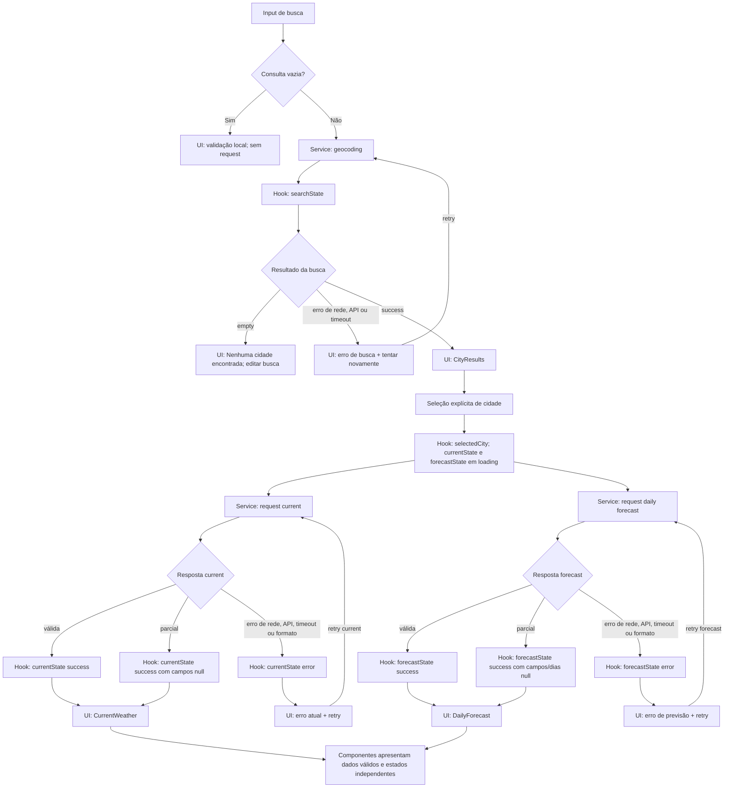

# Plano Técnico — Weather App

## Architecture

Aplicação SPA em camadas, sem backend próprio. A dependência segue da composição da tela para a orquestração, e desta para os serviços; serviços não importam componentes ou hooks:

```text
App.tsx
  ├── hooks/useWeather
  │     ├── services/openMeteo ── Open-Meteo Geocoding + Forecast
  │     └── lib (funções puras)
  └── components (props e callbacks; sem acesso à rede)

types (contratos compartilhados; sem dependência das outras camadas)
```

### Responsabilidades e testabilidade

- **Apresentação (`components/`):** renderizar props e encaminhar ações por callbacks. Não chama `fetch`, não conhece endpoints, não mantém estado de negócio e não interpreta DTOs. Isso permite testar estados e interações com Testing Library sem rede.
- **Orquestração (`hooks/`):** manter busca, cidade selecionada, unidade e estados assíncronos independentes; coordenar seleção, cancelamento e retry. Recebe serviços como dependências substituíveis nos testes, permitindo verificar loading, sucesso, falha parcial e retry sem montar a aplicação inteira.
- **Acesso a dados (`services/`):** construir URLs/parâmetros, fazer `fetch`, aplicar timeout, validar payloads e normalizar DTOs para os tipos de domínio. Testes usam `fetch` mockado e fixtures, sem depender de disponibilidade externa.
- **Funções puras (`lib/`):** conversão/arredondamento de temperatura, formatação com fuso e tradução de códigos WMO. Sem React, I/O ou estado; cada função é testada diretamente com entradas e saídas conhecidas.
- **Contratos (`types/`):** definir tipos de domínio compartilhados; não contém comportamento nem importa UI, hook ou serviço.

`App.tsx` é o ponto de composição: instancia o hook e distribui estado e callbacks aos componentes. O clima atual e a previsão são requests e estados independentes para que a falha de uma seção não esconda o sucesso da outra, conforme RF2-AC03 e RF3-AC04.

## Tech Stack

- **React 19 + TypeScript strict + Vite:** stack existente; componentes para apresentação e Vite para desenvolvimento/build da SPA.
- **Tailwind CSS:** estilo responsivo conforme stack do projeto.
- **Open-Meteo Geocoding e Forecast:** endpoints públicos sem credencial privada no cliente. Aprovar cobertura, CORS, termos, atribuição exigida e limites para as regiões de lançamento antes de publicar.
- **Vitest + Testing Library:** testes unitários, de hooks e de interação acessível.
- **Playwright:** testes E2E e verificações de viewport, teclado e fluxo completo.
- **Biome + pnpm:** lint/formatação e gerenciamento de dependências já configurados.
- **Acessibilidade automatizada:** adicionar `axe-core`/`@axe-core/playwright` como dependência de desenvolvimento para verificar violações WCAG; complementar com testes de teclado e revisão manual.

## Project Structure

```text
src/
  components/
    SearchForm.tsx             # entrada e envio de busca
    CityResults.tsx            # seleção explícita de cidade
    CurrentWeather.tsx         # apresentação do clima atual
    DailyForecast.tsx          # apresentação dos cinco dias
    TemperatureUnitToggle.tsx  # seleção Celsius/Fahrenheit
    states/
      LoadingState.tsx
      EmptyState.tsx
      ErrorState.tsx
  hooks/
    useWeather.ts              # estado e coordenação dos fluxos
  services/
    openMeteo.ts               # geocoding, requests e normalização de DTOs
  lib/
    temperature.ts             # conversão e arredondamento
    weatherCodes.ts            # código WMO -> rótulo pt-BR
    dateFormatting.ts          # data/hora no fuso selecionado
  types/
    weather.ts                 # City, CurrentWeather, ForecastDay, WeatherData, Unit
  App.tsx
  main.tsx                     # bootstrap React
```

Manter um componente por arquivo, conforme a convenção do projeto. Testes ficam fora de `src/`, em `tests/unit/` (lib e services), `tests/components/` (UI e hooks) e `tests/e2e/` (Playwright). Evitar camada de cache, store global, repositório genérico ou cliente HTTP adicional: o escopo tem uma tela, uma cidade selecionada e não persiste dados.

## Data Model

Contratos de domínio; respostas brutas da API ficam privadas ao serviço e não são consumidas diretamente pela UI.

```ts
export type Unit = "celsius" | "fahrenheit";

export interface City {
  id: number | null; // Identificador GeoNames, quando retornado; usar coordenadas como fallback de identidade.
  name: string; // Nome da cidade retornado em name.
  adminRegion: string | null; // Região administrativa de admin1, quando disponível.
  country: string | null; // Nome do país retornado em country, quando disponível.
  countryCode: string | null; // Código ISO do país retornado em country_code, quando disponível.
  latitude: number; // Latitude usada nas consultas meteorológicas.
  longitude: number; // Longitude usada nas consultas meteorológicas.
  timeZone: string; // Fuso IANA retornado em timezone, usado para datas e horários locais.
}

export interface CurrentWeather {
  temperatureC: number | null; // temperature_2m, solicitada em Celsius.
  apparentTemperatureC: number | null; // apparent_temperature, solicitada em Celsius.
  weatherCode: number | null; // weather_code WMO, convertido em rótulo pt-BR na apresentação.
  relativeHumidityPercent: number | null; // relative_humidity_2m, em porcentagem.
  windSpeedKmh: number | null; // wind_speed_10m, solicitada em km/h.
  observedAtLocal: string | null; // current.time, horário local associado ao fuso de City.
}

export interface ForecastDay {
  date: string; // daily.time, data local no formato YYYY-MM-DD.
  weatherCode: number | null; // daily.weather_code WMO, convertido em rótulo pt-BR.
  minimumTemperatureC: number | null; // daily.temperature_2m_min, solicitada em Celsius.
  maximumTemperatureC: number | null; // daily.temperature_2m_max, solicitada em Celsius.
  precipitationProbabilityPercent: number | null; // daily.precipitation_probability_max, em porcentagem.
  maximumWindSpeedKmh: number | null; // daily.wind_speed_10m_max, solicitada em km/h.
}

export interface WeatherData {
  city: City; // Cidade selecionada e identidade geográfica/fuso das medições.
  current: CurrentWeather; // Dados atuais normalizados, em unidades canônicas.
  forecast: ForecastDay[]; // Cinco dias locais, de hoje até hoje mais quatro dias.
}

type RequestErrorKind = "network" | "api" | "timeout" | "invalid-response";

type AsyncState<T> =
  | { status: "idle" }
  | { status: "loading" }
  | { status: "success"; data: T }
  | { status: "empty"; data: T }
  | { status: "error"; kind: RequestErrorKind };
```

O resultado normalizado de geocodificação contém no máximo cinco `City`. Região, país, código do país e identificador podem faltar na resposta; coordenadas e fuso são necessários para confirmar e consultar uma cidade. Quando não houver `id`, usar o par de coordenadas como identidade estável do resultado. Campos meteorológicos ausentes são `null` e viram “Indisponível” na apresentação. O mapper preenche as cinco datas esperadas da previsão; para data sem resposta, os campos ficam `null`. `WeatherData` representa a composição quando clima atual e previsão foram carregados; na UI, as duas seções mantêm `AsyncState` independentes para preservar falhas parciais.

Temperaturas são mantidas em Celsius no domínio. `Unit` é estado de apresentação, começa em `celsius`, permanece apenas durante a página aberta e não é persistido. Na renderização, um helper puro recebe o valor Celsius original e a unidade selecionada; para Fahrenheit usa $F = C \times 9/5 + 32$. O helper aplica uma casa decimal e empate para longe de zero. Alternar a unidade atualiza somente o estado de apresentação: não limpa dados, não chama service e não inicia novo request. Assim, conversões repetidas sempre partem do valor canônico e não acumulam arredondamento.

## Data Flow

1. A pessoa envia a busca. A UI remove espaços externos; valor vazio mostra validação local e não chama a API (RF1-AC03).
2. `useWeather` solicita geocodificação ao service. O service aplica timeout de 10 s, valida o formato e normaliza no máximo cinco resultados. Zero resultados é um estado vazio, não erro.
3. A pessoa seleciona uma cidade. A UI mostra sua identidade geográfica e inicia, em paralelo, uma consulta de clima atual e outra de previsão diária.
4. Cada consulta transforma sua resposta para o modelo de domínio, preservando valores ausentes como `null`. O estado de cada seção é atualizado independentemente.
5. A previsão usa as datas locais fornecidas pelo endpoint configurado com o fuso IANA da cidade; a tela apresenta hoje e os quatro dias seguintes.
6. A UI formata condição, data, horário e temperatura em pt-BR. Alternar °C/°F só recalcula a apresentação, sem novas requisições.
7. Uma nova busca aborta a busca anterior e consultas meteorológicas associadas à cidade anterior, evitando que respostas atrasadas sobrescrevam a seleção atual.



Os requests `current` e `daily` usam o mesmo endpoint Forecast, mas são separados para manter seus estados e retries independentes. Respostas parciais continuam em `success`; campos/dias ausentes são apresentados como indisponíveis, conforme RF2-AC02 e RF3-AC03.

## External APIs

Todas as chamadas são HTTPS, com timeout de 10 s, e ficam encapsuladas em `services/openMeteo.ts`. Os exemplos abaixo são esquemáticos e mostram apenas os campos usados pelo produto.

### Geocoding

- **URL:** `https://geocoding-api.open-meteo.com/v1/search`
- **Parâmetros:** `name=<consulta>` (texto após trim), `count=5`, `language=pt`, `format=json`.
- **Exemplo resumido de resposta:**

```json
{
  "results": [
    {
      "id": 123456,
      "name": "Campinas",
      "latitude": -22.9056,
      "longitude": -47.0608,
      "timezone": "America/Sao_Paulo",
      "country": "Brasil",
      "country_code": "BR",
      "admin1": "São Paulo"
    }
  ]
}
```

- **Mapeamento para `City`:** `id` → `id`; `name` → `name`; `admin1` → `adminRegion`; `country` → `country`; `country_code` → `countryCode`; `latitude`/`longitude` → coordenadas; `timezone` → `timeZone`. Campos geográficos opcionais ausentes viram `null`. Coordenadas e fuso são necessários para selecionar/consultar a cidade; rejeitar resultado sem eles como localidade não consultável.
- Uma resposta sem `results` ou com lista vazia é “Nenhuma cidade encontrada”, não erro de transporte.

### Forecast

- **URL:** `https://api.open-meteo.com/v1/forecast`
- **Coordenadas e unidades comuns:** `latitude=<City.latitude>`, `longitude=<City.longitude>`, `temperature_unit=celsius`, `wind_speed_unit=kmh`, `timezone=<City.timeZone>`.
- **Chamada de clima atual:** adicionar `current=temperature_2m,apparent_temperature,relative_humidity_2m,weather_code,wind_speed_10m`.
- **Chamada de previsão diária:** adicionar `daily=weather_code,temperature_2m_min,temperature_2m_max,precipitation_probability_max,wind_speed_10m_max` e `forecast_days=5`.
- Os parâmetros `current` e `daily` são enviados em requests separados ao mesmo endpoint para que falhas e novas tentativas sejam independentes.

**Exemplo resumido de resposta atual:**

```json
{
  "timezone": "America/Sao_Paulo",
  "current_units": { "temperature_2m": "°C", "wind_speed_10m": "km/h" },
  "current": {
    "time": "2026-10-29T12:00",
    "temperature_2m": 24.5,
    "apparent_temperature": 25.1,
    "relative_humidity_2m": 61,
    "weather_code": 2,
    "wind_speed_10m": 11.2
  }
}
```

**Exemplo resumido de resposta diária:**

```json
{
  "timezone": "America/Sao_Paulo",
  "daily_units": {
    "temperature_2m_min": "°C",
    "temperature_2m_max": "°C",
    "precipitation_probability_max": "%",
    "wind_speed_10m_max": "km/h"
  },
  "daily": {
    "time": ["2026-10-29", "2026-10-30"],
    "weather_code": [2, 61],
    "temperature_2m_min": [18.1, 17.4],
    "temperature_2m_max": [27.3, 25.8],
    "precipitation_probability_max": [10, 70],
    "wind_speed_10m_max": [14.0, 18.5]
  }
}
```

- **Mapeamento para `CurrentWeather`:** `current.temperature_2m` → `temperatureC`; `apparent_temperature` → `apparentTemperatureC`; `weather_code` → `weatherCode`; `relative_humidity_2m` → `relativeHumidityPercent`; `wind_speed_10m` → `windSpeedKmh`; `current.time` → `observedAtLocal`.
- **Mapeamento para `ForecastDay`:** para cada índice `i` alinhado entre os arrays, `daily.time[i]` → `date`, `weather_code[i]` → `weatherCode`, `temperature_2m_min[i]`/`temperature_2m_max[i]` → temperaturas mínima/máxima, `precipitation_probability_max[i]` → `precipitationProbabilityPercent` e `wind_speed_10m_max[i]` → `maximumWindSpeedKmh`. O mapper normaliza cinco datas locais; datas/campos ausentes ficam `null` conforme os contratos.
- **Mapeamento para `WeatherData`:** compor `city` selecionada, `current` normalizado e `forecast` normalizada após ambas as chamadas terem sucesso. A UI ainda mantém estados assíncronos separados para apresentar sucesso parcial.

Validar status HTTP, formato JSON, comprimento/alinhamento dos arrays e valores numéricos finitos antes de normalizar. Unidades devem corresponder às solicitadas; um código WMO desconhecido produz condição indisponível, sem descartar os outros campos. Nunca consumir nomes de campos arbitrários da resposta diretamente na UI.

## State Management

Estado local, sem store global, localStorage ou servidor:

- **`SearchForm`:** mantém apenas o texto digitado (`query`) e validação de campo obrigatório. Ao enviar, chama `searchCities(query)` no hook; espaços externos são removidos antes do service.
- **`useWeather`:** mantém `searchState: AsyncState<City[]>`, `selectedCity: City | null`, `currentState: AsyncState<CurrentWeather>`, `forecastState: AsyncState<ForecastDay[]>` e `unit: Unit`.
- **`App.tsx`:** compõe hook e componentes; não duplica estado nem lógica de negócio.

Significado dos estados por recurso:

- **`idle`:** ainda não solicitado; clima e previsão permanecem assim até uma cidade ser selecionada.
- **`loading`:** request em andamento; cada recurso muda de estado independentemente.
- **`success`:** resposta válida com dados utilizáveis.
- **`empty`:** request bem-sucedido sem resultados; usado para busca vazia do provedor, com lista vazia e mensagem “Nenhuma cidade encontrada”. Não representa falha.
- **`error`:** request falhou; guarda apenas uma categoria técnica tipada, sem payload ou mensagem bruta do provedor.

Ao enviar uma nova busca, limpar a seleção anterior e seus dados para não associar a previsão antiga aos novos resultados. Ao selecionar uma cidade, iniciar clima atual e previsão em paralelo. Cada retry reinicia somente o recurso acionado; uma seção bem-sucedida permanece visível se a outra falhar. Cancelar requests obsoletos com `AbortController`; cancelamento por troca de cidade não deve produzir mensagem de erro.

## Error Handling

- **Rede (`network`):** falha de conexão ou `fetch` rejeitado; marcar apenas o recurso afetado como `error`, informar que os dados não carregaram e oferecer retry manual.
- **API (`api`):** resposta HTTP não-2xx ou erro comunicado pelo provedor; não tratar como lista vazia. Exibir mensagem recuperável e retry manual.
- **Timeout (`timeout`):** abortar cada request após 10 s e apresentar erro recuperável para aquele recurso. Um request ainda em andamento após esse prazo não bloqueia o outro.
- **Resposta inválida (`invalid-response`):** JSON ilegível, estrutura incompatível, unidade inesperada ou valor numérico não finito; rejeitar o payload daquele recurso em vez de renderizar dado incorreto e oferecer retry.
- **Resposta parcial válida:** manter cada campo válido; `null` vira “Indisponível”, dia sem dados vira “Previsão indisponível”. Não substituir lacunas por zero, estimativa ou dados antigos.
- **Falha parcial:** não limpar o recurso que teve sucesso; mensagem e retry ficam limitados à seção com erro.
- **Código WMO desconhecido:** condição “Indisponível”, mantendo os demais campos meteorológicos válidos.
- **Cancelamento obsoleto:** ignorar o resultado quando request foi cancelado por nova busca/seleção; não exibir erro nem permitir que a resposta antiga sobrescreva a cidade atual.
- Erros visíveis são mensagens pt-BR estáveis por categoria; não expor stack, URL, payload ou texto bruto do provedor. Não persistir diagnóstico ou telemetria.

## Testing Strategy

- **Vitest — funções puras (`tests/unit/`):** conversão °C/°F sem acumular arredondamento, positivos/negativos e empates; formatação de datas no fuso da cidade; mapeamento WMO conhecido/desconhecido. Validar também valores nulos e arredondamento de uma casa decimal.
- **Vitest — services (`tests/unit/`):** construir URLs e parâmetros; trim e limite de cinco resultados; mapear DTOs Open-Meteo; alinhar arrays diários; normalizar campos ausentes; distinguir lista vazia de erro; lidar com HTTP não-2xx, JSON inválido, desconexão e timeout. Mockar `fetch` e relógios, sem chamar a rede real.
- **Testing Library — componentes e hook (`tests/components/`):** testar cada fluxo em `idle`, `loading`, `success`, `empty` e `error`; verificar conteúdo de sucesso, mensagem vazia, mensagem/ação de retry e resposta parcial. Confirmar que erro de uma seção não remove a outra, que retry atualiza só o recurso correspondente e que alternar unidade não invoca novamente os services. Usar `user-event` para teclado e interações, com queries por role/label.
- **Playwright — E2E (`tests/e2e/`):** cobrir busca → escolha entre localidades → clima atual e cinco datas → alternância °C/°F → busca de outra cidade. Com `page.route`, simular resposta normal, lista vazia, erro HTTP, timeout, resposta parcial e retry; não depender do serviço público. Em viewport de 320 CSS px, validar ausência de rolagem horizontal e acesso aos controles essenciais por toque; verificar também fluxo de teclado e axe nos fluxos principais.
- **Release:** executar `pnpm lint`, `pnpm build`, `pnpm test` e `pnpm test:e2e`; aferir o LCP conforme o perfil RNF4 e validar HTTPS/CSP no hosting publicado. Aprovação de cobertura, licença, CORS e limites do Open-Meteo é verificação operacional separada, não substituída pelos mocks.

## Risks & Trade-offs

- **Clima atual e previsão em requests separados:** escolhido para isolar erros e retries por seção; alternativa: um request Forecast com `current` e `daily`, reduzindo tráfego, mas acoplando a disponibilidade das seções. Custo da escolha: duas chamadas por cidade e maior consumo de cota.
- **Celsius canônico e conversão na apresentação:** escolhido para alternar unidade sem request e sem arredondamento acumulado; alternativa: buscar novamente na unidade escolhida, com mais latência e chamadas, ou manter estados duplicados em Celsius/Fahrenheit, com risco de divergência.
- **Estado local em hook:** escolhido por haver uma tela e nenhuma persistência; alternativa: Context/store global, que facilitaria compartilhamento entre muitas telas, mas adicionaria abstração e manutenção sem benefício atual.
- **Sem cache ou atualização automática:** escolhido para não mostrar dados antigos como atuais e seguir a spec; alternativa: cache ou atualização em background melhoraria tolerância à rede e reduziria chamadas, mas exigiria política de validade e tratamento de dados obsoletos.
- **Mapeamento WMO local:** escolhido como função pura sem dependência de runtime; alternativa: biblioteca ou serviço de localização, com manutenção/custo de dependência. Custo atual: atualizar o mapa quando surgirem códigos sem rótulo, mantendo fallback “Indisponível”.
- **APIs mockadas nos testes:** escolhido para testes determinísticos e independentes da rede; alternativa: chamar Open-Meteo em cada suite, o que aumenta flakiness e pode consumir cota. A validação real do provedor fica no gate de release.
- **Validação axe além dos testes manuais de teclado:** adiciona dependência de desenvolvimento e detecta apenas uma parte dos problemas WCAG; é complementada por testes de teclado e revisão manual, não tratada como prova completa de conformidade.
- **Gate externo do Open-Meteo:** cobertura, licença, atribuição, CORS e limites precisam de aprovação antes da publicação; se não forem aprovados, interromper o release e decidir com produto, sem trocar silenciosamente de provedor.